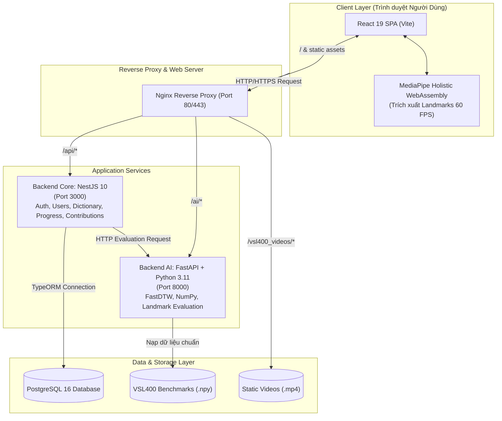

# 🤟 Signlingo - Nền Tảng Học Ngôn Ngữ Ký Hiệu Việt Nam Thông Minh (VSL)

<p align="center">
  
  
  
  
  
  
  
  
</p>

<p align="center">
  <strong>Signlingo</strong> là giải pháp học tập Ngôn ngữ Ký hiệu Việt Nam (VSL - Vietnamese Sign Language) tiên phong, kết hợp công nghệ <strong>Thị giác Máy tính (Computer Vision)</strong> và <strong>Trí tuệ Nhân tạo (AI)</strong> chạy thời gian thực trên webcam. Hệ thống hỗ trợ chấm điểm cử chỉ, phản hồi sai sót ngay lập tức, cá nhân hóa lộ trình học và xây dựng cộng đồng đóng góp từ điển ký hiệu mở cho người khiếm thính và cộng đồng hòa nhập tại Việt Nam.
</p>

<p align="center">
  🌐 <strong>Website chính thức:</strong> <a href="https://signlingo.id.vn">https://signlingo.id.vn</a>
</p>

---

## 📑 Mục Lục
- [🌟 Tính Năng Cốt Lõi](#-tính-năng-cốt-lõi)
- [🏗️ Kiến Trúc Hệ Thống](#️-kiến-trúc-hệ-thống)
- [💻 Công Nghệ Sử Dụng (Tech Stack)](#-công-nghệ-sử-dụng-tech-stack)
- [📁 Cấu Trúc Thư Mục](#-cấu-trúc-thư-mục)
- [🚀 Hướng Dẫn Cài Đặt & Khởi Chạy](#-hướng-dẫn-cài-đặt--khởi-chạy)
  - [Cách 1: Chạy bằng Docker Compose (Khuyên dùng)](#cách-1-chạy-nhanh-với-docker-compose-khuyên-dùng)
  - [Cách 2: Chạy thủ công từng dịch vụ (Local Development)](#cách-2-chạy-thủ-công-từng-dịch-vụ-cho-lập-trình-viên)
- [⚙️ Biến Môi Trường (.env)](#️-biến-môi-trường-env)
- [📖 Tài Liệu API & Tài Khoản Thử Nghiệm](#-tài-liệu-api--tài-khoản-thử-nghiệm)
- [🌐 Triển Khai Máy Chủ Production (VPS)](#-triển-khai-máy-chủ-production-vps)
- [🤝 Đóng Góp Phát Triển (Contributing)](#-đóng-góp-phát-triển-contributing)
- [📄 Giấy Phép (License)](#-giấy-phép-license)

---

## 🌟 Tính Năng Cốt Lõi

### 1. 🎥 AI Studio: Chấm Điểm Cử Chỉ Ký Hiệu Thời Gian Thực
- **Trích xuất mốc cơ thể (Client-side MediaPipe Holistic)**: Thu nhận 543 điểm mốc (bàn tay, ngón tay, cánh tay, khuôn mặt) trực tiếp trên trình duyệt với tốc độ 30–60 FPS mà không làm rò rỉ hình ảnh camera của người dùng.
- **Thuật toán so khớp chuỗi thời gian (FastDTW & Cosine Similarity)**: So sánh chuỗi tọa độ thực hiện của người học với kho chuẩn benchmark (.npy) của từ vựng VSL400.
- **Phản hồi chi tiết (Real-time Feedback)**: Chấm điểm độ khép mở ngón tay, hướng lòng bàn tay, quỹ đạo di chuyển và vị trí tương đối so với cơ thể (ngực, trán, cằm).

### 2. 🗺️ Lộ Trình Học Cá Nhân Hóa & Chuẩn VSL
- **12 Chủ đề thiết yếu**: Từ Gặp gỡ, Gia đình, Số đếm, Màu sắc, Đồ ăn đến Cảm xúc và Giao tiếp khẩn cấp.
- **Cơ chế Thích ứng (Adaptive Learning)**: Đánh giá điểm mạnh/yếu của từng học viên để gợi ý bài học cần ôn luyện trước khi bước sang cấp độ mới.

### 3. 📖 Từ Điển Ký Hiệu VSL 400 Từ & Video Đa Góc Quay
- Tra cứu nhanh từ vựng ký hiệu kèm **video góc quay chính diện và góc nghiêng**.
- Hỗ trợ phương ngữ 3 miền: **Hà Nội, TP. Hồ Chí Minh, Đà Nẵng**.
- Mô tả chi tiết hình dạng bàn tay và chuyển động đặc thù.

### 4. 🎓 Ngữ Pháp Ký Hiệu VSL & 100+ Mẫu Câu Đàm Thoại
- Hệ thống hóa các quy tắc trật tự từ đặc trưng của VSL (Chủ - Vị - Trạng, câu nghi vấn, câu phủ định, biểu cảm khuôn mặt mang nghĩa ngữ pháp).
- Hơn 100 câu đàm thoại thông dụng theo ngữ cảnh thực tế đời sống.

### 5. 🤝 Nền Tảng Đóng Góp Từ Vựng Mở Từ Cộng Đồng
- Người học và các chuyên gia ngôn ngữ ký hiệu có thể **đóng góp từ vựng mới** kèm video hướng dẫn.
- Quản trị viên duyệt từ: Hệ thống **tự động tích hợp từ được phê duyệt vào kho từ điển và bài học** cho toàn bộ người dùng.

### 6. 🎮 Mini-game Phản Xạ 5s & Ôn Tập Ngắt Quãng (Spaced Repetition)
- Thử thách phản xạ ký hiệu trong 5 giây giúp khắc sâu kiến thức vào trí nhớ dài hạn.
- Cơ chế Flashcard lặp lại ngắt quãng tự động lên lịch từ vựng sắp quên.

### 7. 📱 Trải Nghiệm Tối Ưu Đa Nền Tảng (Mobile & Desktop)
- Tương thích 100% trên điện thoại di động (Bottom Navigation, Top Bar rút gọn, Mobile Drawer linh hoạt) và máy tính (Sidebar mở rộng, Stats Bar theo dõi tiến độ).

### 8. 🛡️ Bảng Điều Khiển Quản Trị Hệ Thống (Admin Portal)
- Quản lý kho từ vựng và chủ đề bài học.
- Kiểm duyệt đóng góp từ vựng cộng đồng (Duyệt / Từ chối kèm lý do).
- Công cụ tiền xử lý video sang benchmark `.npy` tự động.
- Quản lý danh sách người dùng và thống kê học tập toàn hệ thống.

---

## 🏗️ Kiến Trúc Hệ Thống

Hệ thống Signlingo được thiết kế theo kiến trúc Microservices hiện đại, tối ưu hóa cho xử lý tính toán AI và độ trễ thấp:



---

## 💻 Công Nghệ Sử Dụng (Tech Stack)

| Thành phần | Công nghệ | Mục đích |
|---|---|---|
| **Frontend** | React 19, Vite 8, Lucide React, Canvas Confetti | Giao diện Single Page Application hiện đại, tải siêu nhanh |
| **Thị giác Máy tính** | Google MediaPipe Holistic & Hands | Trích xuất tọa độ xương ngón tay và cơ thể trên trình duyệt |
| **Backend Core** | NestJS 10, TypeORM, TypeScript | Quản lý logic nghiệp vụ, bảo mật JWT, RESTful API |
| **Backend AI** | Python 3.11, FastAPI, Uvicorn, NumPy, SciPy, FastDTW | Thuật toán so khớp chuỗi thời gian Dynamic Time Warping |
| **Cơ sở dữ liệu** | PostgreSQL 16 (Hỗ trợ fallback SQLite cho local dev) | Lưu trữ người dùng, tiến độ, từ vựng, đóng góp cộng đồng |
| **Web Server** | Nginx Alpine | Reverse proxy, cân bằng tải, SSL Terminate, cache tĩnh |
| **DevOps** | Docker, Docker Compose, Linux UFW, Systemd | Đóng gói container chuẩn hóa, triển khai tự động lên VPS |

---

## 📁 Cấu Trúc Thư Mục

```
Signlingo/
├── backend-ai/                  # Dịch vụ Python AI chấm điểm cử chỉ (FastAPI)
│   ├── models/benchmarks/       # Kho mốc tọa độ chuẩn (.npy + _meta.json) của VSL400
│   ├── main.py                  # API endpoints tính điểm cử chỉ, FastDTW logic
│   ├── process_all_vsl400.py    # Script trích xuất mốc landmarks hàng loạt từ video
│   ├── convert_videos_h264.py   # Script chuẩn hóa định dạng video MP4 H.264
│   ├── Dockerfile               # Docker container cho Backend AI
│   └── requirements.txt         # Dependencies Python (FastAPI, NumPy, FastDTW, SciPy)
├── backend-core/                # Dịch vụ nghiệp vụ chính (NestJS + TypeORM)
│   ├── src/
│   │   ├── config/              # Cấu hình TypeORM (PostgreSQL / SQLite)
│   │   ├── modules/
│   │   │   ├── auth/            # Đăng ký, đăng nhập JWT, hash mật khẩu bcrypt
│   │   │   ├── users/           # Quản lý tài khoản và phân quyền (Admin / Learner)
│   │   │   ├── dictionary/      # Quản lý chủ đề (Topic), bài học, từ vựng (Word)
│   │   │   ├── contributions/   # Hệ thống đóng góp từ vựng cộng đồng & kiểm duyệt
│   │   │   ├── sentences/       # Quản lý câu đàm thoại thường gặp
│   │   │   ├── progress/        # Lưu trữ điểm, streak, tim, lịch sử luyện tập
│   │   │   ├── adaptive/        # Thuật toán cá nhân hóa & ôn tập ngắt quãng
│   │   │   └── seed/            # Tự động nạp dữ liệu VSL400 ban đầu
│   │   ├── app.module.ts        # Root module NestJS
│   │   └── main.ts              # Entrypoint cấu hình CORS, ValidationPipe, Swagger
│   ├── Dockerfile               # Docker container cho Backend Core
│   └── package.json             # Dependencies NestJS & TypeScript
├── frontend/                    # Giao diện Web (React 19 + Vite)
│   ├── public/                  # Tài nguyên tĩnh, video bài học VSL400
│   ├── src/
│   │   ├── components/          # Toàn bộ components giao diện (Admin, AIStudio, Contributions,...)
│   │   ├── data/                # Dữ liệu từ vựng VSL400, ngữ pháp, câu giao tiếp
│   │   ├── services/            # Client API (api.js) và bộ theo dõi skeleton (MediaPipe)
│   │   ├── App.jsx              # Điều hướng chính, quản lý auth & responsive layout
│   │   └── index.css            # Hệ thống CSS Design System
│   ├── Dockerfile               # Multi-stage build (Node build -> Nginx serving)
│   ├── nginx.conf               # Cấu hình Nginx reverse proxy cho production
│   └── package.json             # Dependencies React 19 & Vite
├── scripts/                     # Kịch bản tự động hóa & triển khai VPS
│   ├── setup-vps.sh             # Kịch bản cài đặt tự động từ A-Z trên máy chủ Ubuntu
│   └── generate_100_sentences.js# Tạo dữ liệu câu đàm thoại mở rộng
├── docker-compose.yml           # Khởi chạy toàn bộ hệ thống 4 containers
├── .env.example                 # Mẫu khai báo biến môi trường
└── README.md                    # Tài liệu hướng dẫn dự án
```

---

## 🚀 Hướng Dẫn Cài Đặt & Khởi Chạy

### Yêu Cầu Môi Trường
- **Docker** 24.0+ và **Docker Compose** v2+ (Nếu chạy container).
- Hoặc nếu chạy thủ công:
  - **Node.js** v20.x trở lên & **npm** 10.x+.
  - **Python** 3.11+.
  - **PostgreSQL** 16+ (hoặc có thể dùng SQLite tự động có sẵn trong mã nguồn).

---

### Cách 1: Chạy Nhanh với Docker Compose (Khuyên Dùng)

Đây là phương thức nhanh nhất và đảm bảo môi trường đồng nhất 100%:

```bash
# 1. Clone repository
git clone https://github.com/DungUETK68/Signlingo.git
cd Signlingo

# 2. Tạo file cấu hình môi trường từ mẫu
cp .env.example .env

# 3. Khởi chạy toàn bộ hệ thống bằng Docker Compose
docker compose up -d --build
```

Sau khi hoàn tất, hệ thống sẽ tự động khởi tạo:
- 🌐 **Frontend Web App:** `http://localhost` (hoặc `http://localhost:5173`)
- ⚙️ **Backend Core API & Swagger Docs:** `http://localhost:3000/api/docs`
- 🧠 **Backend AI Service:** `http://localhost:8000/docs`
- 🐘 **PostgreSQL Database:** `localhost:5432`

---

### Cách 2: Chạy Thủ Công Từng Dịch Vụ Cho Lập Trình Viên

#### 1. Khởi chạy Backend AI (Python / FastAPI)
```bash
cd backend-ai

# Tạo và kích hoạt môi trường ảo
python -m venv venv
# Windows:
.\venv\Scripts\activate
# Linux/macOS:
source venv/bin/activate

# Cài đặt thư viện
pip install -r requirements.txt

# Khởi chạy server
python -m uvicorn main:app --reload --port 8000
```

#### 2. Khởi chạy Backend Core (NestJS)
```bash
cd backend-core

# Cài đặt dependencies
npm install

# Khởi chạy dev server (Hệ thống tự động seed dữ liệu VSL400 ban đầu)
npm run start:dev
```

#### 3. Khởi chạy Frontend (React + Vite)
```bash
cd frontend

# Cài đặt dependencies
npm install

# Khởi chạy Vite dev server
npm run dev
```
Trình duyệt sẽ mở ứng dụng tại: `http://localhost:5173`.

---

## ⚙️ Biến Môi Trường (.env)

Tạo file `.env` tại thư mục gốc với các thông số cấu hình:

```env
# ==========================================
# Cấu hình Cơ sở dữ liệu PostgreSQL
# ==========================================
DB_HOST=postgres
DB_PORT=5432
DB_USER=postgres
DB_PASSWORD=your_secure_password
DB_NAME=signlingo
DB_SYNCHRONIZE=true

# ==========================================
# Cấu hình Backend Core (NestJS)
# ==========================================
PORT=3000
JWT_SECRET=your_super_secret_jwt_key_at_least_32_characters
JWT_EXPIRATION=7d

# ==========================================
# Cấu hình Backend AI (FastAPI)
# ==========================================
AI_PORT=8000
AI_SERVICE_URL=http://backend-ai:8000
```

---

## 📖 Tài Liệu API & Tài Khoản Thử Nghiệm

### Tài Liệu API Tương Tác
- **Core API Swagger:** `http://localhost:3000/api/docs` (Cung cấp đầy đủ đặc tả OpenAPI, JWT Bearer Token, kiểm thử trực tiếp).
- **AI Service OpenAPI:** `http://localhost:8000/docs` (Mô tả thuật toán chấm điểm và endpoint upload video).

### Tài Khoản Thử Nghiệm Mặc Định
Hệ thống tích hợp sẵn tài khoản Quản trị viên khởi tạo tự động khi seed:
- **Email:** `admin@signlingo.com`
- **Mật khẩu:** `123456`
- **Vai trò:** Quản trị viên (truy cập toàn quyền tab Quản trị, duyệt từ vựng cộng đồng, tiền xử lý dữ liệu).

> *Lưu ý: Học viên thông thường có thể tự đăng ký tài khoản mới trực tiếp tại màn hình Đăng ký của hệ thống.*

---

## 🌐 Triển Khai Máy Chủ Production (VPS)

Dự án đi kèm kịch bản tự động hóa tối ưu cho máy chủ Ubuntu/Debian ([setup-vps.sh](scripts/setup-vps.sh)):

```bash
# Trên máy chủ VPS (Ubuntu 22.04 LTS / 24.04 LTS):
git clone https://github.com/DungUETK68/Signlingo.git /root/Signlingo
cd /root/Signlingo

# Cấp quyền thực thi và chạy kịch bản thiết lập
chmod +x scripts/setup-vps.sh
sudo ./scripts/setup-vps.sh
```

**Kịch bản tự động thực hiện:**
1. Cấu hình DNS đa tầng ổn định.
2. Tự động tạo phân vùng nhớ ảo **2GB Swap RAM** (giúp build Docker an toàn trên VPS dung lượng RAM thấp 1–2GB).
3. Thiết lập tường lửa UFW mở cổng an toàn (SSH, HTTP 80, HTTPS 443).
4. Cài đặt Docker & Docker Compose Engine chính thức từ Docker Inc.
5. Tự động sinh `JWT_SECRET` và mật khẩu Database bảo mật ngẫu nhiên.
6. Build và khởi chạy 4 containers nền tảng hoạt động liên tục với cờ `restart: unless-stopped`.

---

## 🤝 Đóng Góp Phát Triển (Contributing)

Mọi đóng góp nhằm hoàn thiện giải pháp học ngôn ngữ ký hiệu cho cộng đồng đều được hoan nghênh:

1. **Fork** repository này về tài khoản của bạn.
2. Tạo nhánh tính năng mới:
   ```bash
   git checkout -b feature/tinh-nang-moi
   ```
3. Commit các thay đổi có ý nghĩa:
   ```bash
   git commit -m "feat: bổ sung thêm tính năng X"
   ```
4. Push nhánh của bạn:
   ```bash
   git push origin feature/tinh-nang-moi
   ```
5. Mở một **Pull Request** trên GitHub để cùng thảo luận và review mã nguồn.

---

## 📄 Giấy Phép (License)

Dự án được xây dựng phục vụ mục đích học tập, nghiên cứu và hỗ trợ cộng đồng Khiếm thính Việt Nam.
Bản quyền © 2026 **Signlingo Team**. Mọi quyền được bảo lưu.
